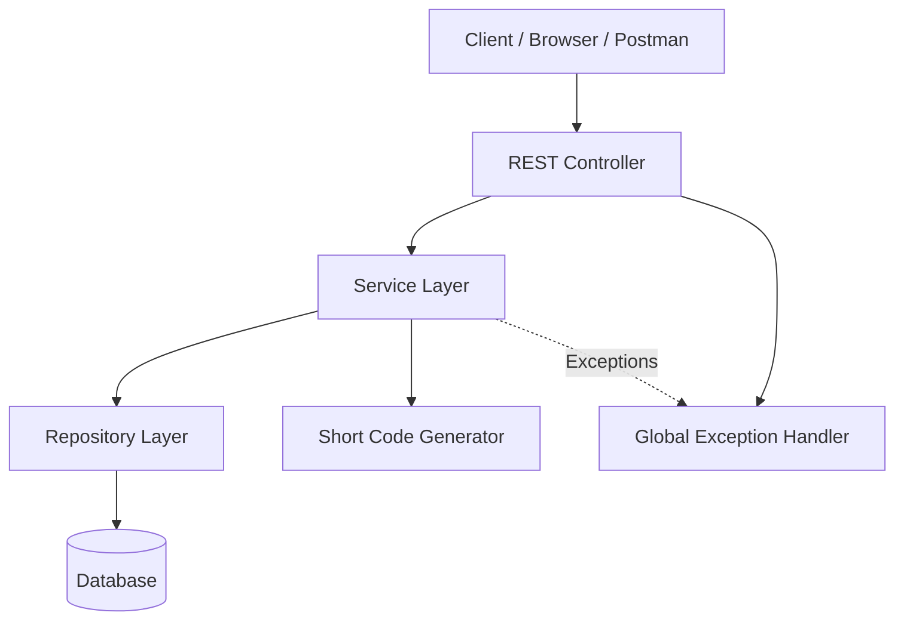
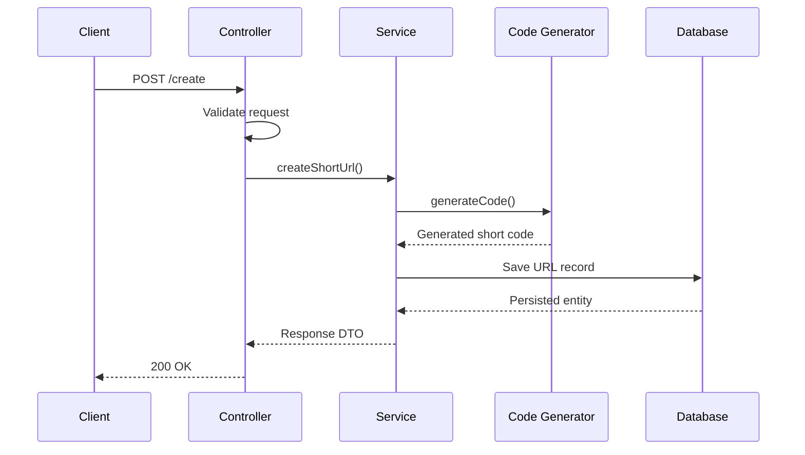
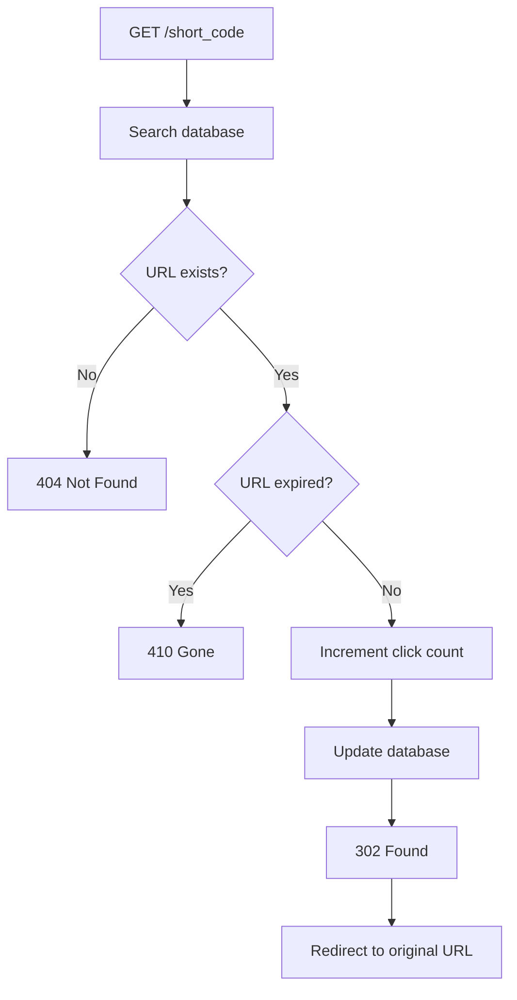

# 🔗 URL Shortener

A RESTful URL Shortener built using Java, Spring Boot, and Spring Data JPA that converts long URLs into short, shareable links.

The application supports automatic short-code generation, URL redirection, link expiration, click tracking, input validation, and centralized exception handling.


---

## 📌 Features

- Convert long URLs into short, shareable links.
- Automatic short-code generation.
- Redirect users to the original URL using HTTP 302.
- Time-based URL expiration.
- Click count tracking for individual URLs.
- UUID-based resource identification.
- URL input validation using Jakarta Bean Validation.
- Custom exceptions for expired and non-existent URLs.
- Centralized exception handling.
- Persistent storage using Spring Data JPA.
- Layered architecture with separation of concerns.
- DTO-based request and response handling.
- Constructor-based dependency injection.

---

## 🛠️ Technology Stack

| Technology | Purpose |
|------------|---------|
| Java | Backend programming language |
| Spring Boot | Application framework |
| Spring Web | REST API development |
| Spring Data JPA | Database operations |
| Hibernate | Object-relational mapping |
| Jakarta Validation | Request validation |
| Maven | Build and dependency management |
| Postman | API testing |

---

## 🏗️ System Architecture

The application follows a layered architecture to maintain
separation of concerns, modularity, and maintainability.



### Architecture Layers

| Layer | Responsibility |
|-------|----------------|
| Controller | Handles HTTP requests and responses |
| Service | Implements business logic |
| Repository | Performs database operations |
| Entity | Represents persisted database records |
| DTO | Transfers request and response data |
| Utility | Generates short codes |
| Exception | Handles application-specific errors |

---

## 📂 Project Structure

```text
src/
└── main/
    ├── java/
    │   └── tech.vivek.urlshortner/
    │       ├── controller/
    │       │   └── UrlController.java
    │       ├── service/
    │       │   └── UrlService.java
    │       ├── repository/
    │       │   └── UrlRepository.java
    │       ├── entity/
    │       │   └── UrlRegisterEntity.java
    │       ├── dto/
    │       │   ├── UrlRegisterDto.java
    │       │   └── UrlRegisterResponseDto.java
    │       ├── exception/
    │       │   ├── GlobalExceptionHandler.java
    │       │   ├── UrlNotFoundException.java
    │       │   └── UrlExpiredException.java
    │       └── utility/
    │           └── CodeGenerator.java
    └── resources/
        └── application.properties
```

---

## 🚀 API Endpoints

| Method | Endpoint | Description |
|--------|----------|-------------|
| POST | `/create` | Generate a shortened URL |
| GET | `/{short_code}` | Redirect to the original URL |

### 1. Create a Short URL

**Endpoint**

```http
POST /create
```

**Request Headers**

```http
Content-Type: application/json
```

**Request Body**

```json
{
  "url": "https://www.example.com/products/category/electronics"
}
```

**Example Response — 200 OK**

```json
{
  "id": "550e8400-e29b-41d4-a716-446655440000",
  "original_url": "https://www.example.com/products/category/electronics",
  "short_code": "AbCd1234",
  "created_at": "2026-11-26T10:30:00",
  "expires_at": "2026-12-06T10:30:00"
}
```

The generated short URL can be accessed using:

```text
http://localhost:8080/AbCd1234
```

### 2. Redirect to Original URL

**Endpoint**

```http
GET /{short_code}
```

**Example Request**

```http
GET /AbCd1234
```

**Response — 302 Found**

```http
HTTP/1.1 302 Found
Location: https://www.example.com/products/category/electronics
```

When a valid short URL is accessed, the application:

1. Retrieves the URL record from the database.
2. Checks whether the URL has expired.
3. Increments the click count.
4. Persists the updated record.
5. Redirects the client to the original URL.

---

## 🔄 Application Workflow

### URL Creation



### URL Redirection



---

## 🗄️ Database Design

The URL entity stores the following information:

| Field | Description |
|-------|-------------|
| id | Unique UUID identifier |
| original_url | Original destination URL |
| short_code | Generated URL identifier |
| created_at | URL creation timestamp |
| expires_at | URL expiration timestamp |
| click_count | Number of successful redirect requests |

Each shortened URL is associated with its original URL,
creation time, expiration time, and click count.

---

## ✅ Input Validation

The application uses Jakarta Bean Validation to validate
incoming requests before processing them.

### Validation Rules

- The URL must not be null, empty, or blank.
- The URL must begin with `http://` or `https://`.

### Valid Request

```json
{
  "url": "https://www.example.com"
}
```

### Invalid Requests

```json
{
  "url": ""
}
```

```json
{
  "url": "ftp://example.com"
}
```

Invalid requests are rejected by the validation layer.

---

## ⚠️ Exception Handling

Centralized exception handling is implemented using
Spring's `@RestControllerAdvice` and `@ExceptionHandler`.

| HTTP Status | Description |
|-------------|-------------|
| 200 OK | Short URL successfully created |
| 302 Found | Successful URL redirection |
| 400 Bad Request | Invalid request data |
| 404 Not Found | Short URL does not exist |
| 410 Gone | Short URL has expired |
| 500 Internal Server Error | Unexpected application error |

### URL Not Found

```text
No URL Found for AbCd1234
```

### URL Expired

```text
URL is expired!
```

### Internal Server Error

```text
Internal Server Error
```

Custom exceptions:

- `UrlNotFoundException`
- `UrlExpiredException`

This approach separates exception handling from business
logic and provides consistent HTTP error responses.

---

## ⚙️ Getting Started

### Prerequisites

- JDK compatible with the project's Spring Boot version.
- Apache Maven or Maven Wrapper.
- A configured relational database.
- Git.
- Postman or cURL (optional).

### 1. Clone the Repository

```bash
git clone https://github.com/YOUR_USERNAME/url-shortener.git
cd url-shortener
```

### 2. Configure the Database

Update the database configuration in:

```text
src/main/resources/application.properties
```

```properties
spring.datasource.url=YOUR_DATABASE_JDBC_URL
spring.datasource.username=YOUR_DATABASE_USERNAME
spring.datasource.password=YOUR_DATABASE_PASSWORD

spring.jpa.hibernate.ddl-auto=update
spring.jpa.show-sql=true

server.port=8080
```

Ensure that the corresponding JDBC driver is included
in the project's Maven dependencies.

### 3. Build the Application

```bash
mvn clean install
```

### 4. Run the Application

```bash
mvn spring-boot:run
```

The application will be available at:

```text
http://localhost:8080
```

---

## 🧪 Testing the API

### Create a Short URL

```bash
curl -X POST http://localhost:8080/create \
  -H "Content-Type: application/json" \
  -d '{"url":"https://www.google.com"}'
```

### Check Redirection Headers

```bash
curl -i http://localhost:8080/AbCd1234
```

### Follow the Redirect

```bash
curl -L http://localhost:8080/AbCd1234
```

### Test a Non-Existent URL

```bash
curl -i http://localhost:8080/invalid123
```

Expected status:

```text
404 Not Found
```

### Recommended Test Scenarios

| Test Scenario | Expected Result |
|---------------|-----------------|
| Create URL with valid HTTPS link | 200 OK |
| Create URL with valid HTTP link | 200 OK |
| Submit an empty URL | 400 Bad Request |
| Submit an unsupported URL protocol | 400 Bad Request |
| Access a valid short URL | 302 Found |
| Access an unknown short code | 404 Not Found |
| Access an expired short URL | 410 Gone |
| Access a valid URL repeatedly | Click count increases |

---

## 🧠 Technical Concepts Demonstrated

- Object-Oriented Programming (OOP)
- RESTful API design
- Dependency Injection
- Inversion of Control
- Constructor Injection
- Layered Backend Architecture
- Data Transfer Object (DTO) Pattern
- Repository Pattern
- Object-Relational Mapping (ORM)
- Spring Data JPA query methods
- Jakarta Bean Validation
- Custom Exception Handling
- HTTP Redirection
- Database Persistence
- Timestamp-based Resource Expiration

---

## 📈 Future Enhancements

- [ ] Redis caching for faster URL lookups.
- [ ] Short-code collision detection and retry mechanism.
- [ ] Atomic click count updates for concurrent requests.
- [ ] API rate limiting using Bucket4j or Redis.
- [ ] Custom URL aliases.
- [ ] Configurable URL expiration.
- [ ] URL analytics dashboard.
- [ ] QR code generation.
- [ ] User authentication using Spring Security and JWT.
- [ ] Scheduled cleanup of expired URLs.
- [ ] Swagger/OpenAPI documentation.
- [ ] Unit testing using JUnit and Mockito.
- [ ] Integration testing using Testcontainers.
- [ ] Docker containerization.
- [ ] AWS cloud deployment.
- [ ] CI/CD pipeline using GitHub Actions.

---

## 👨‍💻 Author

**Vivek Kumar**

Java | Spring Boot | Backend Development | REST APIs

---

If you find this project useful, consider giving the
repository a ⭐.
